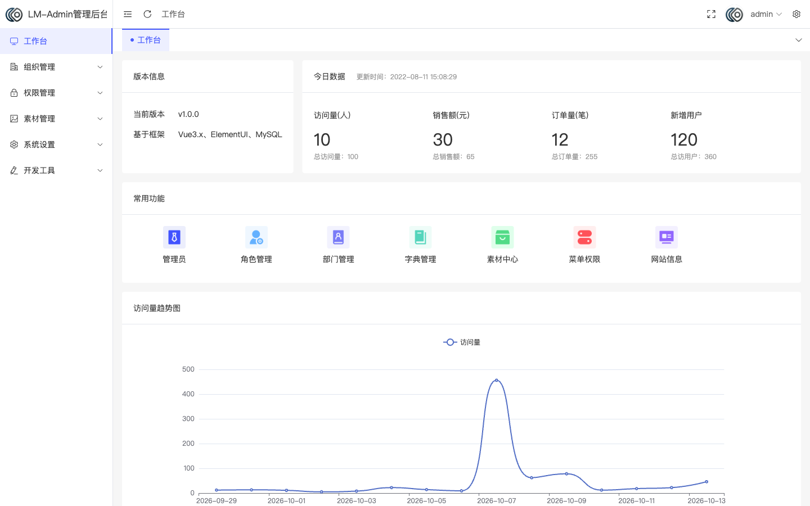
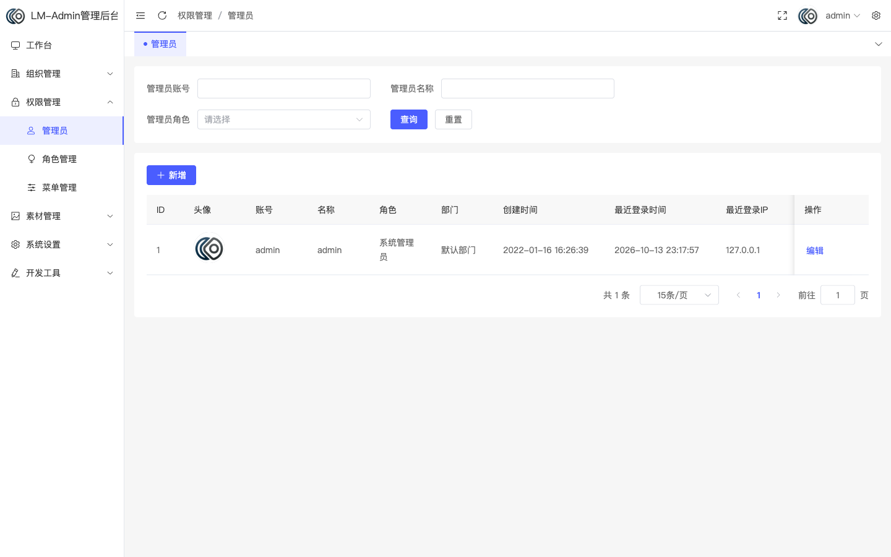
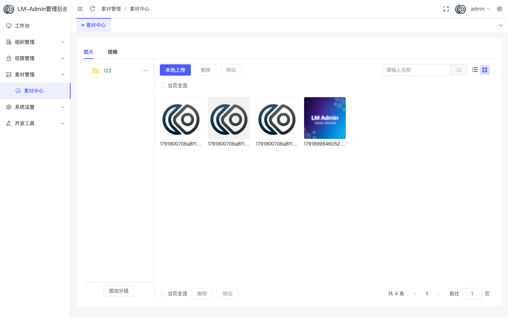
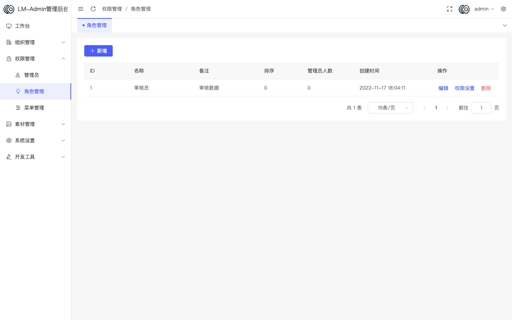
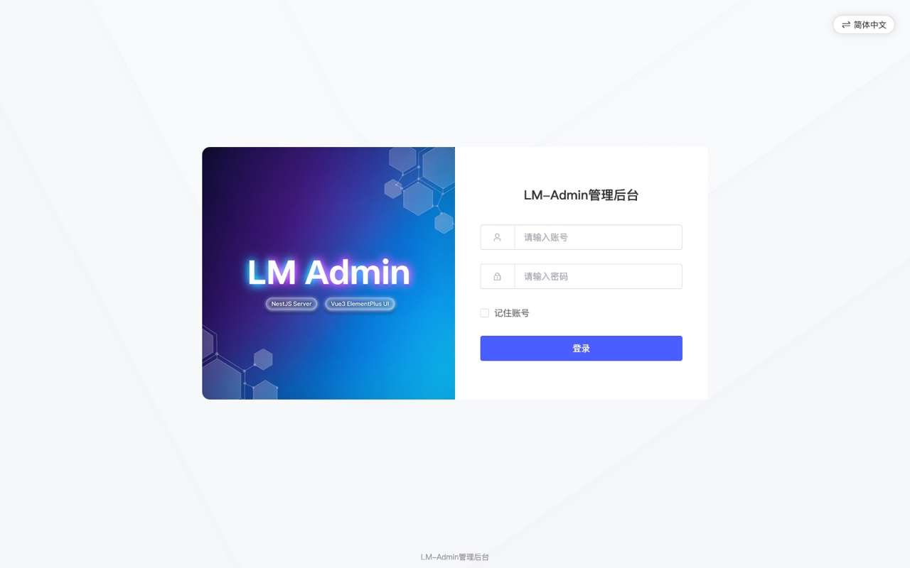

<div align="center">

# 🐾 小怪兽 Admin · lm_admin

**前后端分离的通用后台管理系统**

权限管理 · 组织架构 · 数据字典 · 素材中心 · 微信渠道 · 可视化装修 · 中英双语

[](https://vuejs.org/)
[](https://vitejs.dev/)
[](https://www.typescriptlang.org/)
[](https://element-plus.org/)
[](https://pinia.vuejs.org/)
[](https://tailwindcss.com/)
[](https://vue-i18n.intlify.dev/)

[](https://nestjs.com/)
[](https://sequelize.org/)
[](https://nodejs.org/)
[](https://www.mysql.com/)
[](https://redis.io/)
[](#-开源协议)

[](https://about.dancelynx.win/)

**简体中文** | [English](README.en.md)

</div>

---

## 📸 界面预览

<div align="center">







</div>

## ✨ 功能特性

| | 模块 | 说明 |
| :---: | --- | --- |
| 🔐 | **权限管理** | 菜单 / 角色 / 管理员三级模型，权限串精确到按钮（前端 `v-perms` 指令 + 后端中间件双重校验） |
| 🏢 | **组织架构** | 部门、岗位管理 |
| 📚 | **数据字典** | 字典类型与字典数据，前端 `useDictOptions` 开箱可用 |
| 🗂 | **素材中心** | 图片 / 视频分组管理，批量移动、重命名、删除；本地上传 + 七牛云存储 |
| 📰 | **内容与用户** | 文章 / 栏目管理、消费用户列表与详情 |
| 📱 | **微信渠道** | 公众号菜单与自动回复、小程序 / H5 渠道配置 |
| 🎨 | **可视化装修** | 拖拽式页面装修 + 底部导航配置 |
| ✉️ | **消息通知** | 通知公告、短信 |
| ⚙️ | **系统设置** | 网站信息 / 备案 / 政策协议、存储设置、系统维护（环境、缓存、日志） |
| 📊 | **工作台** | 常用功能入口与数据概览 |
| 🌏 | **多语言** | 内置简体中文 / English 语言包，一键切换 |
| 🧩 | **前端约定** | 组件自动注册、API 自动导入、路由由后端菜单动态下发 |

## 🛠 技术栈

| 端 | 技术 |
| --- | --- |
| `admin/` 前端 | Vue 3 · Vite 3 · TypeScript · Element Plus · Pinia · Tailwind CSS · vue-i18n · ECharts |
| `server/` 后端 | NestJS 10 · TypeScript · Sequelize 6（`sequelize-typescript`）· ioredis |
| 数据存储 | MySQL 5.7+（`lm_` 前缀表）+ Redis（token / 权限缓存） |

> 服务端由原 Egg.js 实现改写而来，**接口契约与响应结构保持不变**，前后端可独立部署。

## 📁 目录结构

```
lm_admin
├── admin/            # 前端 Vue 3
│   └── src/
│       ├── api/          # 接口封装
│       ├── views/        # 页面
│       ├── components/   # 全局组件（按目录名自动注册）
│       ├── locales/      # 中英文语言包
│       ├── stores/       # Pinia
│       └── utils/request # axios 封装
├── server/           # 后端 NestJS
│   ├── src/
│   │   ├── common/       # 配置、认证中间件、异常、工具
│   │   ├── models/       # Sequelize 模型（对应 lm_* 表）
│   │   └── modules/      # system / common / setting / monitor
│   └── public/           # 静态资源与上传目录
├── sql/install.sql   # 数据库结构与初始数据
├── sql/migrations/   # 增量迁移脚本（全新环境按需执行）
└── CLAUDE.md         # 架构说明与开发约定（面向 AI 助手，同样适合人类阅读）
```

## ⚡ 快速开始

### 1. 初始化数据库

```bash
mysql -uroot -p -e "CREATE DATABASE lm_admin DEFAULT CHARSET utf8mb4;"
mysql -uroot -p lm_admin < sql/install.sql
```

### 2. 启动后端

```bash
cd server
cp .env.example .env     # 按需修改 MySQL / Redis 连接
npm install
npm run dev              # watch 模式，默认 http://127.0.0.1:8001
```

> ⚠️ 启动**不会**自动同步表结构，改表需修改 `sql/install.sql` 或在数据库中手动执行。

### 3. 启动前端

```bash
cd admin
npm install
npm run dev              # 默认 http://localhost:5173
```

前端接口地址取自 `admin/.env.development` 的 `VITE_APP_BASE_URL`（默认 `http://localhost:8001`），
需与后端 `.env` 的 `PORT` 一致。Vite 未配置代理，跨域由后端 `enableCors({ origin: '*' })` 处理。

### 4. 登录

初始账号：`admin` / `123456`

## 🌏 多语言

前端内置 **简体中文 / English** 两套语言包（`admin/src/locales/lang/`），默认中文，
切换入口在登录页右上角与顶栏用户下拉，偏好存于 `localStorage`。

当前覆盖框架层（布局、登录页、错误页、公共组件、通用提示）；业务页面文案保持中文，
可按 `src/locales/lang/{zh-cn,en}/` 下的同名命名空间增量补齐。

<div align="center">




<sub>同一登录页：简体中文 / English</sub>

</div>

## 🔌 接口约定

所有接口挂在 `/api` 下，**业务失败也返回 HTTP 200**，前端只按响应体的 `code` 分支处理：

```json
{ "code": 200, "data": {}, "message": "请求成功", "msg": "请求成功" }
```

`msg` 与 `message` 等价，为兼容前端拦截器（其读取的是 `msg`）而同时输出。

| code | 说明 | code | 说明 |
| :---: | --- | :---: | --- |
| 200 | 成功 | 332 | token 参数为空 |
| 300 | 业务失败 | 333 | token 参数无效 |
| 310 | 参数校验错误 | 403 | 无相关权限 |
| 330 | 账号或密码错误 | 500 | 系统错误 |
| 331 | 账号已被禁用 | | |

## 📦 构建部署

**后端**

```bash
cd server
npm run build
npm run start:prod       # node dist/main
```

**前端**

```bash
cd admin
cp .env.production.example .env.production   # 填入生产环境接口域名
npm run build
```

> 前端的 `npm run build` 会先执行 `vite build`，再把产物覆盖复制到仓库外的 `../frontend` 目录
> （见 `admin/scripts/build.mjs`，路径为部署约定，修改需谨慎）。

## 🔑 权限模型

后端认证中间件拦截所有 `/api/` 请求，把请求路径转换为权限串（`api/system/admin/self` → `system:admin:self`），
与该角色在 Redis 中缓存的菜单权限列表比对。因此**新增接口后必须在「菜单管理」中配置对应权限串**，
否则非超管访问一律返回 403（也可将其加入 `server/src/common/config.ts` 的 `notLoginUri` / `notAuthUri`）。

## 📖 更多文档

- [`CLAUDE.md`](CLAUDE.md) —— 前后端架构、接口契约与开发约定的完整说明
- [`server/README.md`](server/README.md) —— 服务端目录结构与「与原 Egg 实现的有意差异」清单（改动相关代码前请先阅读）
- [`admin/README.md`](admin/README.md) —— 前端目录结构、自动导入与开发约定

## 👤 作者

<div align="center">

**DanceLynx**

[](https://about.dancelynx.win/)

</div>

## 📄 开源协议

基于 [MIT](LICENSE) 协议开源。

<div align="center">

<sub>Made with ❤️ by <a href="https://about.dancelynx.win/">DanceLynx</a></sub>

</div>
